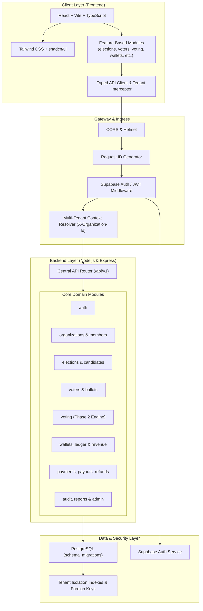

# Votexa Platform - Technical Architecture Document

## 1. Executive Summary & Domain Scope
**Votexa** is an enterprise-grade, multi-tenant voting SaaS platform engineered for institutions, universities, student governments, associations, and corporate boards. It provides end-to-end cryptographic integrity, tenant data isolation, secure voter verification, paid/free election packages, double-entry financial ledger accounting, and administrative oversight.

---

## 2. High-Level System Architecture

---

## 3. Technology Stack Justification

| Layer | Technology | Architecture Decision Rationale |
|---|---|---|
| **Frontend** | React 18, Vite 6, TypeScript 5 | Sub-second HMR dev cycle, high-performance rendering, strict type-safety shared with backend contracts. |
| **Styling & UI** | Tailwind CSS 3, shadcn/ui primitives | Tokenized theme design system supporting light/dark themes, zero-runtime overhead, fully accessible primitives. |
| **Backend** | Node.js 22, Express, TypeScript 5 | Proven enterprise stability, asynchronous I/O, modular controller-service-route pattern, scalable containerization. |
| **Database** | PostgreSQL 15+ | ACID transactions critical for double-entry financial ledger and cryptographic ballot tallying; UUID primary keys; tenant indexing. |
| **Auth** | Supabase Auth (with JWT fallback) | Managed token lifecycle, OAuth/social login support, institutional email validation, decoupled session management. |
| **Monorepo** | npm Workspaces (`client`, `server`, `shared`) | Unified type definitions, synchronized builds, and zero-drift domain models. |

---

## 4. Multi-Tenancy Isolation Model

1. **Logical Isolation with Tenant Context:**
   - Every tenant is represented by a record in `organizations` with a unique UUID.
   - The client includes `X-Organization-Id` in requests (or resolves it via organization membership).
   - Express middleware `tenantContext` intercepts every request, validates tenant membership, and attaches `req.tenant.organizationId`.
   - All tenant-scoped database tables (`elections`, `candidates`, `voters`, `ballots`, `votes`, `wallets`, `financial_ledger`, `audit_logs`) enforce `organization_id NOT NULL REFERENCES organizations(id) ON DELETE CASCADE`.
   - Composite indexes `(organization_id, ...)` guarantee query speed and isolation.

2. **Role-Based Access Control (RBAC):**
   - **System Roles:** `SUPER_ADMIN` (platform management, billing, global telemetry), `USER`.
   - **Organization Roles:**
     - `OWNER`: Full tenant administrative, financial, and deletion rights.
     - `ADMIN`: Election configuration, candidate management, voter import.
     - `MEMBER`: Read-only access to organization dashboards.
     - `AUDITOR`: Independent cryptographic verification and turnout audit access.
     - `VOTER`: Authenticated to cast a ballot in eligible elections.

---

## 5. Security & Secret Isolation Guidelines

1. **Zero Secret Exposure in Frontend:**
   - Frontend only accesses variables prefixed with `VITE_` (`VITE_API_URL`, `VITE_SUPABASE_URL`, `VITE_SUPABASE_ANON_KEY`).
   - Sensitive keys (`SUPABASE_SERVICE_ROLE_KEY`, `DATABASE_URL`, `JWT_SECRET`, Stripe secret keys) are strictly backend-only.
2. **Defensive API Envelope:**
   - No raw database error stacks leaked in production.
   - Global error handler captures exceptions and formats them into `{ success: false, error: { code, message } }`.
3. **Audit Trail:**
   - Every sensitive administrative, voting, and financial transaction creates an immutable record in `audit_logs`.

---

## 6. Roadmap to Phase 2
- **Phase 1 (Current):** Architectural foundation, modular backend, feature-based frontend, database migrations, environment configurations, and CI test runner.
- **Phase 2 (Next):**
  - Implement cryptographic voting engine (ballot hashing, tamper-evident audit log, double-voting prevention).
  - Implement payment gateway integration (Stripe Checkout, webhooks, automatic wallet crediting).

