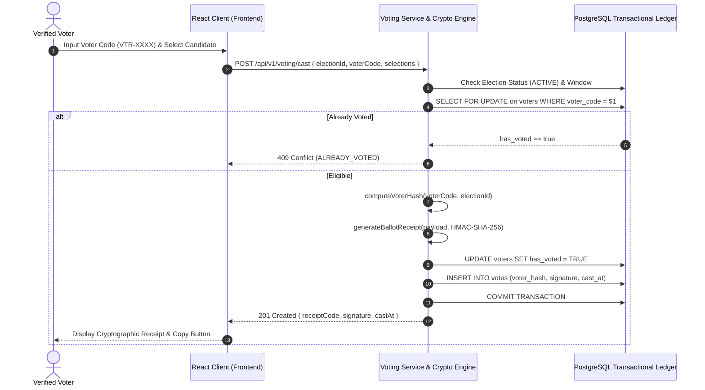

# Votexa Cryptographic Voting Protocol & Security Guarantees

## 1. Overview & Guarantees
The **Votexa Cryptographic Voting Engine** provides four essential guarantees required for high-stakes institutional elections:
1. **Eligibility & Single-Vote Enforcement:** Only verified voters with active, valid credentials can cast a ballot, and no voter can cast more than once.
2. **Voter Anonymity:** The voter's physical identity (name, email) is cryptographically decoupled from their cast selections using an HMAC-SHA-256 one-way voter hash.
3. **Individual Verifiability:** Voters receive a unique cryptographic receipt code (e.g. `VTX-XXXX-XXXX-XXXX-XXXX`) allowing them to verify their ballot was registered in the official ledger.
4. **Universal Verifiability & Tamper Evidence:** Any modification to candidate choices or timestamps invalidates the digital signature.

---

## 2. Cryptographic Workflow

---

## 3. Double-Voting Prevention

Double voting is prevented through three defensive layers:
1. **Database Row Lock:** `SELECT ... FOR UPDATE` acquires an exclusive lock on the voter's record for the duration of the transaction.
2. **Atomic State Transition:** `UPDATE voters SET has_voted = TRUE WHERE has_voted = FALSE` guarantees that concurrent requests cannot both succeed.
3. **Database Unique Constraints:** Unique composite index on `votes(election_id, voter_hash)` prevents any duplicate ballot insertion at the database storage engine layer.

