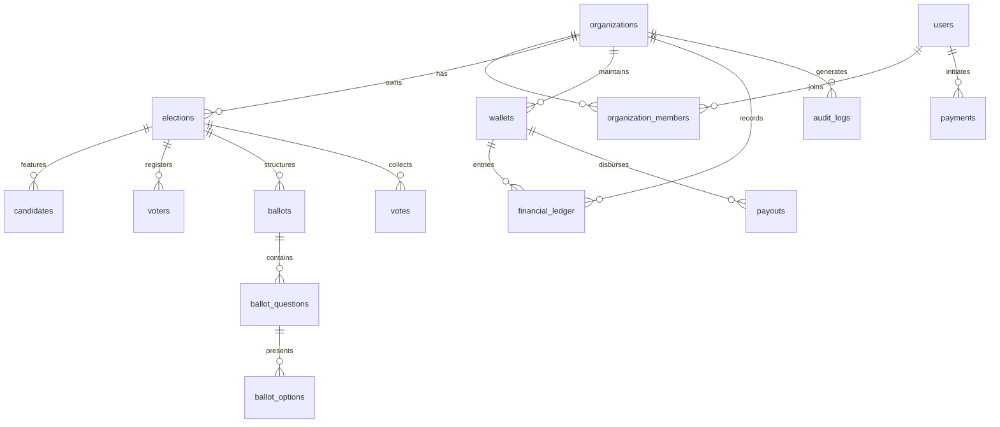

# Votexa PostgreSQL Database Schema Specification

## 1. Entity-Relationship Overview



---

## 2. Table Catalog

| Table | Tenant Scoped | Primary Key | Description |
|---|---|---|---|
| `organizations` | Root Tenant | UUID | Tenant workspace, slug, branding, and billing plan |
| `organization_members` | Yes | UUID | RBAC link between users and organizations |
| `users` | Platform | UUID | Synchronized with Supabase Auth profile |
| `packages` | Platform | UUID | SaaS subscription plans and election quotas |
| `elections` | Yes | UUID | Voting contest parameters, timelines, and status |
| `candidates` | Yes | UUID | Candidate names, bios, ballot order |
| `voters` | Yes | UUID | Voter roll, verification codes, voted flags |
| `ballots` | Yes | UUID | Election ballot container and type |
| `ballot_questions` | Yes (via ballot) | UUID | Individual questions/offices on the ballot |
| `ballot_options` | Yes (via ballot) | UUID | Selectable choices linked to candidates |
| `votes` | Yes | UUID | Cryptographic vote receipt and encrypted payload |
| `wallets` | Yes | UUID | Institutional treasury wallet balance (in cents) |
| `financial_ledger` | Yes | UUID | Immutable double-entry financial transaction record |
| `payments` | Yes | UUID | Gateway transaction logs and metadata |
| `payouts` | Yes | UUID | Organization withdrawal records |
| `refunds` | Yes | UUID | Payment refund records |
| `notifications` | Yes | UUID | In-app user notifications |
| `audit_logs` | Yes | UUID | Immutable compliance trail of platform events |
| `schema_migrations` | System | SERIAL | Version tracking of executed database migrations |

---

## 3. Multi-Tenant Indexing Strategy

To guarantee strict isolation and sub-millisecond lookups across high-volume elections:
- `idx_org_members_org` on `organization_members(organization_id)`
- `idx_elections_org` on `elections(organization_id)`
- `idx_candidates_org` on `candidates(organization_id)`
- `idx_voters_org` on `voters(organization_id)`
- `idx_votes_org` on `votes(organization_id)`
- `idx_ledger_org` on `financial_ledger(organization_id)`
- `idx_audit_org` on `audit_logs(organization_id)`

---

## 4. Running Migrations

Database migrations are executed via the dedicated runner:
```bash
# From workspace root
npm run db:migrate

# Or within server workspace
cd server
npm run db:migrate
```

The migration runner:
1. Connects to PostgreSQL using `DATABASE_URL` (or `DB_HOST`, `DB_PORT`, `DB_NAME`, etc.).
2. Creates `schema_migrations` table if not present.
3. Automatically scans `server/src/database/migrations/*.sql` in alphabetical order.
4. Executes any pending migration inside an atomic `BEGIN ... COMMIT` block.
5. In case of any error, automatically issues a `ROLLBACK` to prevent corrupted states.

