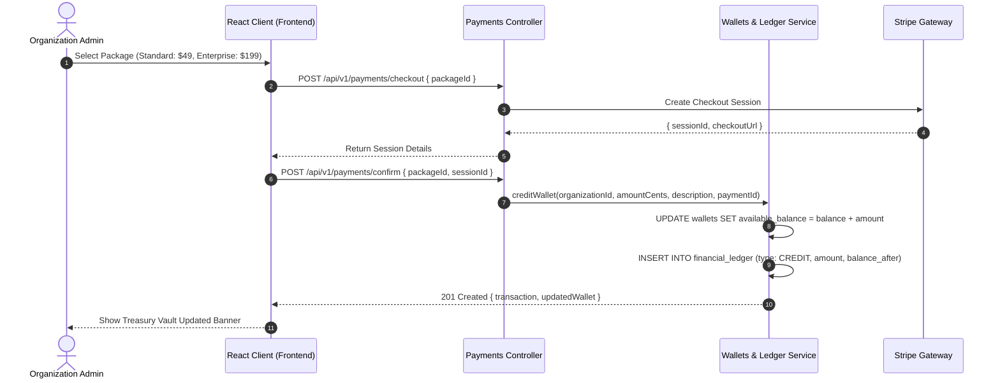

# Votexa Multi-Tenant Financial Treasury & Double-Entry Ledger

## 1. Accounting Philosophy

Votexa implements a strict **double-entry ledger system** for all financial interactions across tenants:
- All financial balances are stored in **smallest currency units (cents)** to prevent floating-point rounding errors.
- Every balance mutation (`CREDIT` or `DEBIT`) generates an immutable entry in the `financial_ledger` table with `balance_after`.
- No wallet balance can ever be directly overwritten via `UPDATE ... SET available_balance = X` without an atomic transaction inserting a corresponding audit row.
- **Overdraft Prevention:** Any withdrawal, refund, or payout that exceeds `available_balance` is rejected with `INSUFFICIENT_FUNDS` (status 400).

---

## 2. Ledger Transaction Types

| Type | Direction | Trigger | Description |
|---|---|---|---|
| `CREDIT` | + Inflow | Package subscription, paid voting ticket | Adds cleared funds to tenant wallet |
| `DEBIT` | - Outflow | Payout disbursement, subscription renewal | Deducts funds from tenant wallet |
| `PLATFORM_FEE`| - Fee | Revenue split deduction | Votexa platform commission |
| `PAYOUT` | - Outflow | Bank account withdrawal | Cleared withdrawal to connected account |
| `REFUND` | - Outflow | Dispute or election cancellation | Reversal of a prior credit |

---

## 3. Stripe & Checkout Flow

