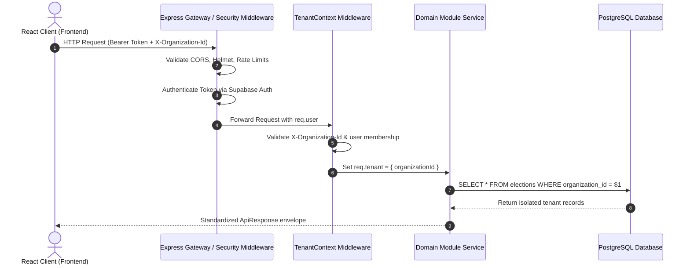
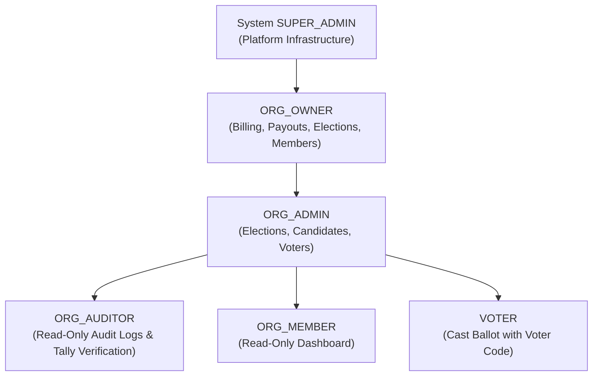

# Votexa Multi-Tenancy Architecture & Security Blueprint

## 1. Multi-Tenancy Strategy

Votexa employs a **Shared Database, Isolated Logical Schema** model with explicit tenant discriminators (`organization_id`) and Row-Level Security (RLS) readiness.

### Key Tenets
1. **Zero Tenant Bleed:** No query across tenant boundaries is ever executed without an explicit `organization_id` constraint.
2. **Deterministic Context Extraction:** The active tenant is extracted on every inbound request and pinned to `req.tenant`.
3. **Defense in Depth:** Even if a malicious request attempts to inject another tenant's entity ID in the path, the query scopes strictly to `WHERE id = $1 AND organization_id = $2`.

---

## 2. Request Lifecycle & Context Resolution

---

## 3. Organization Role Hierarchy

